# Component Selection

**Zander Boward | Team 202: Weather Gadget | LCD Display Board**

## **LCD display subsystem: LCD display**

| **Candidate and unit price** | **Advantages** | **Disadvantages** |
| --- | --- | --- |
| **Newhaven NHD-0420H1Z-FSW-GBW-33V3** $17.04 each 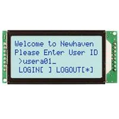 [Link](https://www.digikey.com/en/products/detail/newhaven-display-intl/NHD-0420H1Z-FSW-GBW-33V3/2773595) | Native 3.3 V operation matches the intended MCU logic rail. Four text lines fit a sensor label, reading, units, and status without crowding. Transflective construction supports viewing with ambient light. | A 20x4 module occupies more panel area than a smaller display needed for a single value. Uses six GPIO signals and needs a contrast circuit and backlight current limiting. Character cells limit graphics and plotting. |
| **Adafruit 198 standard 20x4 LCD** $17.95 each 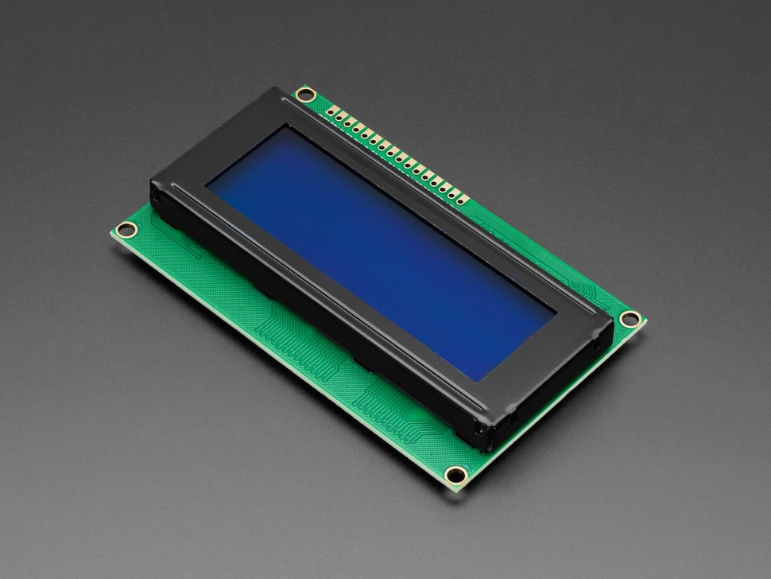 [Link](https://www.adafruit.com/product/198) | A readily available character-display option with a documented parallel interface. Uses a familiar six-signal character interface; includes a contrast potentiometer and header. | Intended for a 5 V supply, so 3.3 V input thresholds must be checked for the supplied controller. A different module requires checking dimensions, backlight load, and firmware timing. |
| **Adafruit 499 RGB 20x4 LCD** $24.95 each 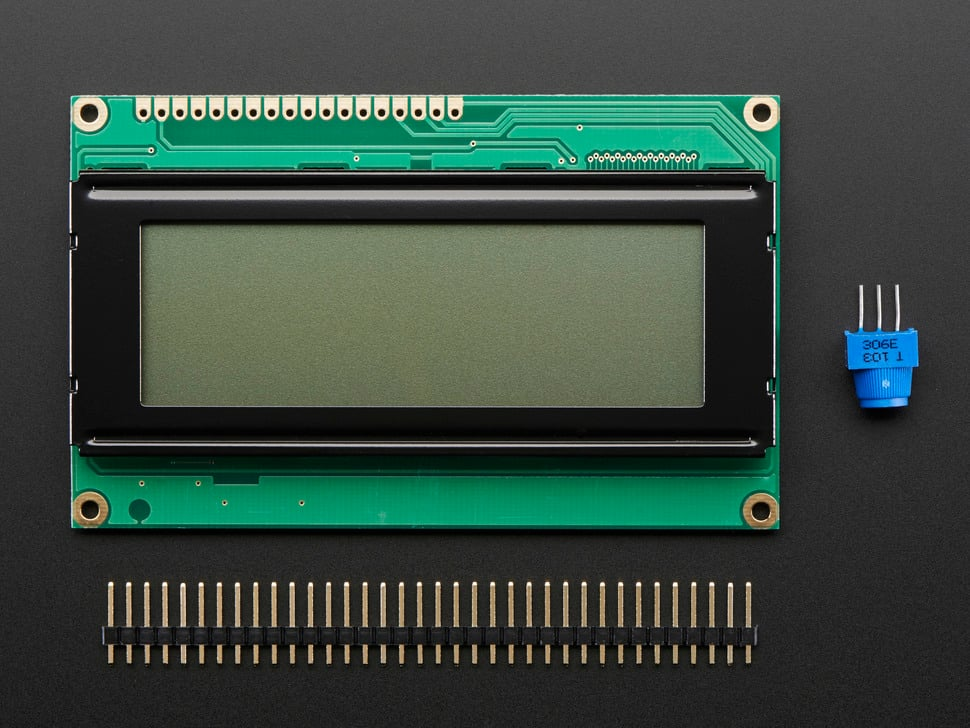 [Link](https://www.adafruit.com/product/499) | Four lines retain the baseline information capacity. Color could indicate weather alerts; includes contrast potentiometer and header. | RGB channels add connections and control work beyond the present diagram. The 5 V backlight and logic arrangement needs a revised electrical check; multiple lit colors increase current. |

**Choice: Newhaven NHD-0420H1Z-FSW-GBW-33V3.**

The Newhaven module is the best choice because its 3.3 V operation matches the MCU target and its 20x4 layout fits allows the user to read units, and status with ease. The $17.04 listing price is also cheaper than its alternatives. Additionally, its 79x36 mm size fits the 100x100 mm PCB limit, and the single-color backlight simplifies the code.

## **LCD display subsystem: 5 V linear regulator**

| **Candidate and unit price** | **Advantages** | **Disadvantages** |
| --- | --- | --- |
| **STMicroelectronics L7805CV** $1.08 each 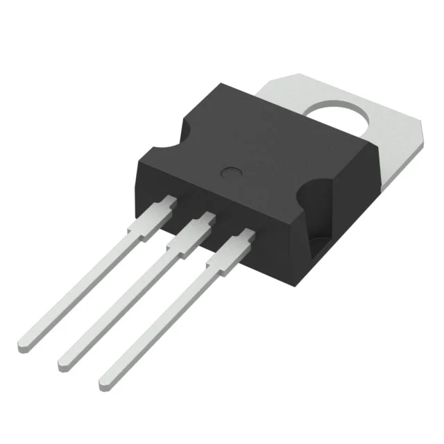 [Link](https://www.digikey.com/en/products/detail/stmicroelectronics/L7805CV/585964) | Fixed output eliminates a feedback-divider adjustment. TO-220 through-hole package is convenient for assembly and heat sinking. | The 9-to-5 V drop produces heat proportional to load. Requires input headroom and a minimum load; the nominal 1.5 A capability is conditional on thermal design. |
| **Texas Instruments LM2940CT-5.0/NOPB** $2.00 each  [Link](https://www.digikey.com/en/products/detail/texas-instruments/LM2940CT-5-0-NOPB/32575) | Lower dropout gives more input-voltage headroom than a conventional 7805. Fixed 5 V output and a TO-220 package suit a through-hole board. | The output capacitor must satisfy its capacitance and ESR requirements. Listed out of stock when checked; costs more and offers little thermal advantage at a fixed 9 V input. |
| **STMicroelectronics LM317T, set to 5 V** $1.13 each  [Link](https://www.digikey.com/en/products/detail/stmicroelectronics/LM317T/591677) | Adjustable output can accommodate later rail changes. TO-220 package supports straightforward hand assembly. | Adds a resistor divider and its tolerance to the output-voltage design. Still dissipates the input-output voltage difference as heat and needs minimum-load verification. |

**Choice: STMicroelectronics L7805CV.**

The L7805CV is optimal for the low-current, wall-powered device. A fixed 9 V source provides sufficient input headroom, while the fixed output simplifies the design. Additionally, the lower-dropout alternative does not reduce the nominal 4 V power loss.

## **LCD display subsystem: 3.3 V linear regulator**

| **Candidate and unit price** | **Advantages** | **Disadvantages** |
| --- | --- | --- |
| **STMicroelectronics LD1117V33** $1.27 each  [Link](https://www.digikey.com/en/products/detail/stmicroelectronics/LD1117V33/586012) | Fixed 3.3 V output matches the display. TO-220 construction and 800 mA rated capability provide assembly convenience and potential expansion headroom. | Up to 10 mA quiescent current is substantial relative to this small load. Requires the datasheet output-capacitor arrangement; the 800 mA rating still requires thermal evaluation. |
| **Microchip MCP1700-3302E/TO** $0.50 each 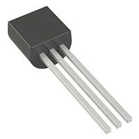 [Link](https://www.digikey.com/en/products/detail/microchip-technology/MCP1700-3302E-TO/652680) | Very low quiescent current reduces idle consumption. Through-hole TO-92 package and a ceramic output-capacitor option simplify a small board. | 250 mA current capability provides less expansion capacity than LD1117. Its 6 V maximum input prevents connection directly to the 9 V source; TO-92 heat dissipation limits usable current. |
| **Texas Instruments LM3940IT-3.3/NOPB** $2.69 each 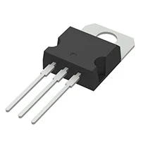 [LInk](https://www.digikey.com/en/products/detail/texas-instruments/LM3940IT-3-3-NOPB/308006) | Designed specifically for conversion from a 5 V bus to 3.3 V. TO-220 package and 1 A capability support a larger load if thermally feasible. | More expensive than either alternative. Needs at least 33 uF output capacitance within the specified ESR window; its intended input range is narrow. |

**Choice: STMicroelectronics LD1117V33.**

The LD1117V33 retains the proposed through-hole regulator and permits a larger future load than the 250 mA. My original choice was the MCP1700, but it costs more and uses substantially more quiescent current than MCP1700, but continuous wall power makes idle efficiency less important than assembly convenience and expansion capacity here. Its 800 mA rating is conditional on thermal design; the present calculated requirement is only 84.375 mA. Verify the 5 V input tolerance and stability capacitor before committing the design.

## **LCD display subsystem: External power source**

| **Candidate and unit price** | **Advantages** | **Disadvantages** |
| --- | --- | --- |
| **Adafruit 63, regulated 9 V / 1 A wall adapter** $8.95 each 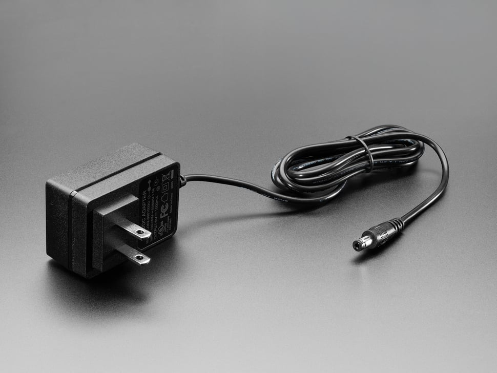 [Link](https://www.adafruit.com/product/63) | Provides headroom for the proposed 5 V stage. Fixed voltage and a center-positive 5.5/2.1 mm plug make repeatable bench operation convenient. | Requires an AC outlet and a cable. Cascaded linear conversion wastes power; the source current rating does not equal regulator thermal capability. |
| **Triad Magnetics WSU090-0800, 9 V / 0.8 A** $8.03 each 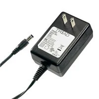 [Link](https://www.digikey.com/en/products/detail/triad-magnetics/WSU090-0800/3094975) | 9 V output preserves the required barrel input and 5 V linear regulator. 0.8 A exceeds the preliminary 109.375 mA input requirement; listed price is lower than Adafruit 63. | Only 0.8 A leaves less reserve for a shared team supply than the other candidates. The documented full-load ambient range is 0 to 40 C; the 11 mm plug length still needs a mechanical fit check. |
| **Triad Magnetics WSU090-2000, 9 V / 2 A** $12.43 each  [Link](https://www.digikey.com/en/products/detail/triad-magnetics/WSU090-2000/3094951) | 9 V output retains both on-board linear stages. 2 A source capacity could support more separately fed team boards after a combined power check. | Costs more than the two alternatives and provides unnecessary capacity for this board alone. Its 77x48x31 mm body occupies more outlet space; source capacity does not remove regulator heating. |

**Choice: Adafruit 63, regulated 9 V / 1 A wall adapter.**

The Adafruit 63 is best for this board because its regulated 9 V output meets the input requirement, its 5.5/2.1 mm plug matches the intended jack type, and 1 A provides ample reserve. It costs $0.92 more than the 0.8 A Triad option for another 0.2 A of capacity, while avoiding the $3.48 extra cost and larger body of the 2 A option.

### **Custom solution considered**

A battery-holder assembly would provide portability but introduces discharge-voltage and runtime requirements that complicated the design. A custom mains supply adds isolation and protection design work with no project benefit; use a finished external adapter.

## **LCD display subsystem: DC input jack**

Provide the barrel input shown in the electrical block diagram.

| **Candidate and unit price** | **Advantages** | **Disadvantages** |
| --- | --- | --- |
| **Same Sky / CUI PJ-002A** $0.58 each 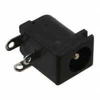 [Link](https://www.digikey.com/en/products/detail/same-sky-formerly-cui-devices/PJ-002A/96962) | Retains the part specified in the diagram. Through-hole right-angle construction integrates the input onto the PCB. | PCB footprint must match the manufacturer drawing; it is not interchangeable with every barrel jack. No inherent polarity protection or cable retention; verify mating dimensions and contact reliability. |
| **Same Sky / CUI PJ-102A** $0.70 each 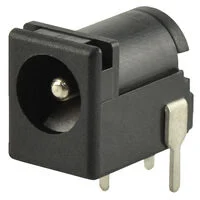 [Link](https://www.digikey.com/en/products/detail/same-sky-formerly-cui-devices/PJ-102A/275425) | Provides a right-angle PCB power connection with an internal switch. A documented through-hole alternative can be evaluated before board layout. | Requires its own footprint and mating-depth check. Costs slightly more than PJ-002A and provides no functional benefit established by this diagram. |
| **Switchcraft 722A panel jack** $4.76 each 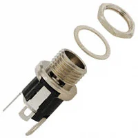 [Link](https://www.digikey.com/en/products/detail/switchcraft-inc/722A/109410) | Panel attachment transfers insertion forces to the enclosure. Solder eyelets allow flexible placement away from the PCB. | Higher unit cost than the PCB-mounted choices. Requires enclosure machining and internal wiring, increasing assembly work. |

**Choice: Same Sky / CUI PJ-002A.**

The PJ-002A matches the planned layout approach and has the lowest observed unit price of these candidates. Its mechanical rating describes the current it can carry, not current it consumes.

## **LCD display subsystem: Enclosure**

| **Candidate and unit price** | **Advantages** | **Disadvantages** |
| --- | --- | --- |
| **Custom 3D Printed Enclosure** Fabrication cost: $0.65 Custom design; no commercial product photo. | Custom LCD opening, button access and mounting bosses can follow the actual hardware. The student can revise the case as connector locations and board dimensions settle. | CAD, printer access, print time and actual material cost are still required. Printed fit, layer strength and clearance around warm regulators need checking; no weatherproof rating is claimed. |
| **Hammond 1591USBK ABS enclosure** $10.54 each 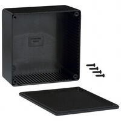 [Link](https://www.digikey.com/en/products/detail/hammond-manufacturing/1591USBK/130891) | A finished box and lid reduce fabrication work; the listing provides mechanical dimensions. Its approximately 120x120 mm footprint is more compact than the larger alternative. | LCD, button and cable openings must be machined into the finished case. Internal card guides and mounting posts reduce usable space; outline dimensions alone do not prove PCB fit. |
| **Hammond 1591ESBK ABS enclosure** $12.19 each 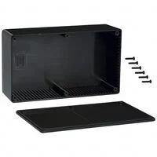 [Link](https://www.digikey.com/en/products/detail/hammond-manufacturing/1591ESBK/130876) | The approximately 190x110 mm footprint gives more length for the display and connectors. A finished lid and molded card guides reduce custom fabrication work. | It costs $1.65 more and occupies more desk area than 1591USBK. Fixed bosses and wall locations still require a fit check and machined openings; modifications need reassessment of protection. |

**Choice: Custom 3D printed enclosure.**

3D printing the enclosure permits the group to focus on designing around the circuit boards rather than worrying if everything will fit together.

## **Interface pin table**

| **MCU / net** | **Destination** | **Direction** | **Purpose** |
| --- | --- | --- | --- |
| RC6 / UART1 TX | J5, J6, J7 pin 1 | Output | Proposed shared command TX; each cable reaches one sensor RX. |
| RC7 / UART1 RX | J5 pin 2 | Input | Humidity sensor TX; dedicated receive line. |
| RD2 / UART2 RX | J6 pin 2 | Input | Pressure sensor TX; dedicated receive line. |
| RA7 / UART3 RX | J7 pin 2 | Input | Temperature sensor TX; use internal oscillator. |
| Not connected | J5, J6, J7 pins 3-5 | Reserved digital | Leave unconnected on the LCD board in this proposal. |
| Not connected | J5, J6, J7 pins 6-7 | Reserved analog | Leave unconnected; no power on the ribbon cables. |
| GND | J5, J6, J7 pin 8 | Ground | Common signal return on every cable. |
| RD0 | LCD pin 4 (RS) | Output | Register select. |
| RD1 | LCD pin 6 (E) | Output | Enable strobe. |
| RD4 | LCD pin 11 (DB4) | Output | Upper data nibble bit 0. |
| RD5 | LCD pin 12 (DB5) | Output | Upper data nibble bit 1. |
| RD6 | LCD pin 13 (DB6) | Output | Upper data nibble bit 2. |
| RD7 | LCD pin 14 (DB7) | Output | Upper data nibble bit 3. |
| RB0 | Button contact | Input | Internal weak pull-up enabled; opposite contact to GND; debounce in firmware. |
| 3.3 V | LCD pin 2 (VDD); Nano VTG | Power | External target supply; Nano VOFF tied to GND. |
| GND | LCD pins 1, 5, 16 | Ground | VSS, R/W, and backlight cathode. R/W low makes the display write-only. |
| Contrast network | LCD pin 3 (V0) | Analog bias | Potentiometer adjustment near GND; verify contrast over operating conditions. |
| 3.3 V via resistor | LCD pin 15 (LED+) | Power | Current-limited backlight; no direct GPIO drive. |
| Not connected | LCD pins 7-10 (DB0-DB3) | Unused | Leave unused during 4-bit operation. |
| GND | Nano GND and VOFF | Ground | Common return and onboard target-regulator disable. |
| 9 V input | L7805CV IN | Power | Jack center contact to regulator input; return to GND. |
| 5 V | L7805CV OUT to LD1117V33 IN | Power | Intermediate rail; no power on the ribbon connector. |
| 3.3 V | LD1117V33 OUT | Power | Feeds LCD and Nano target at VTG. |

