# Component Selection

**Zander Boward | Team 202: Weather Gadget | LCD Display Board**

## Design requirements and revision

This subsystem receives weather readings from three teammate boards and displays one selected reading and its units. The component choices prioritize a readable character display, a push-button interface, separate UART links, external 9 V power, and practical assembly. This update follows the local Revision H design. Earlier candidates are retained below to explain the evolution of the design.

Prices are historical comparison estimates, not current quotes. The latest BOM draft proposes the SunFounder LCD1602 and Triad WSU090-1300; purchasing details and electrical qualification remain subject to confirmation.

## **LCD display subsystem: LCD display**

| **Candidate and unit price** | **Advantages** | **Disadvantages** |
| --- | --- | --- |
| **SunFounder CN0293 LCD1602 — selected** $6.99 each (checked October 30, 2026; before fees) 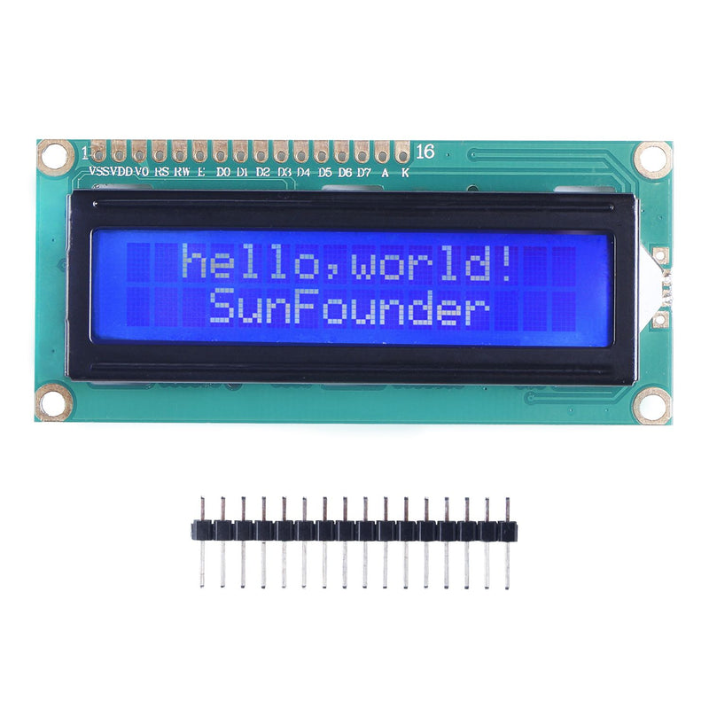 [Manufacturer product page](https://www.sunfounder.com/products/lcd1602-module) | Two rows of 16 characters display a sensor label and reading with units while the button cycles between sources. 5 V logic supply matches the current Nano logic supply; backlight uses a separate 3.3 V connection. 80 x 36 x 12 mm module; lower listed cost than the two 20x4 alternatives. | Displays fewer characters than a 20x4 module. Requires six MCU outputs in four-bit mode, an external 50k contrast trimmer, and soldered headers. Maximum logic/backlight current and mechanical fit still require verification. |
| **Adafruit 198 standard 20x4 LCD** $17.95 each 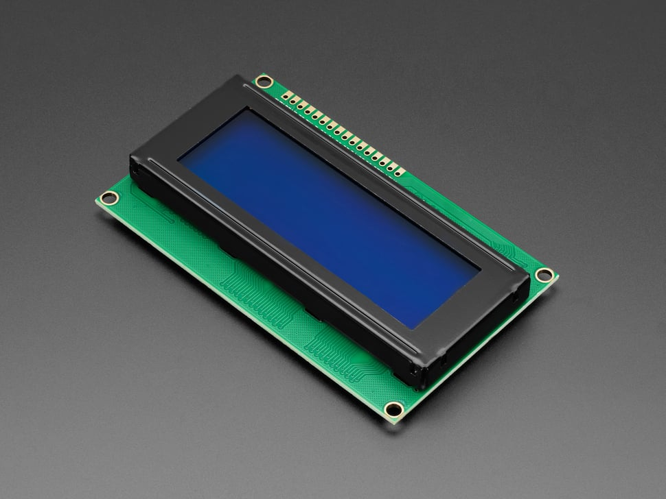 [Link](https://www.adafruit.com/product/198) | A readily available character-display option with a documented parallel interface. Uses a familiar six-signal character interface; includes a contrast potentiometer and header. | Intended for a 5 V supply, so 3.3 V input thresholds must be checked for the supplied controller. A different module requires checking dimensions, backlight load, and firmware timing. |
| **Adafruit 499 RGB 20x4 LCD** $24.95 each 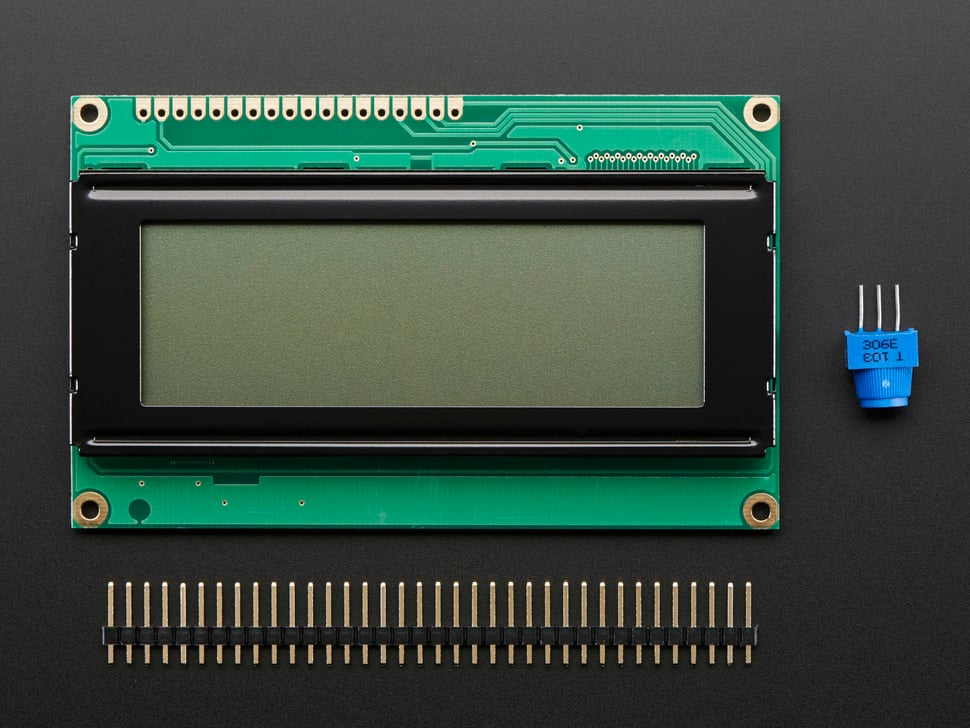 [Link](https://www.adafruit.com/product/499) | Four lines retain the baseline information capacity. Color could indicate weather alerts; includes contrast potentiometer and header. | RGB channels add connections and control work beyond the present diagram. The 5 V backlight and logic arrangement needs a revised electrical check; multiple lit colors increase current. |

**Current choice: SunFounder LCD1602, referenced as CN0293 in the design.**

[Selected LCD product listing](https://www.amazon.com/dp/B071Y6JX3H). The local BOM records a historical $6.99 estimate; confirm the exact supplied model and manufacturer specifications before purchase.

The selected 16x2 parallel character display replaces the earlier Newhaven 20x4 proposal. Two rows support a sensor label and a reading with units, while the button cycles between the three sources. The larger alternatives provide more simultaneous information but are unnecessary for this one-reading-at-a-time interface. The selected module uses 5 V logic power and a separate 3.3 V backlight connection, with an external 50k contrast trimmer. Four-bit operation uses six MCU outputs. Maximum logic/backlight current and physical fit remain to be verified. 

{ width="400" }

*Selected display; image supplied by [SunFounder](https://www.sunfounder.com/products/lcd1602-module). The manufacturer identifies SKU CN0293 and specifies 16x2 characters, 5 V logic supply, a 3.3 V backlight, a 50k contrast adjustment and an 80 x 36 x 12 mm module. Manufacturer-listed price checked October 30, 2026: $6.99 before fees. Confirm the delivered module matches these specifications.*

## **LCD display subsystem: 5 V linear regulator**

| **Candidate and unit price** | **Advantages** | **Disadvantages** |
| --- | --- | --- |
| **STMicroelectronics L7805CV** $1.08 each  [Link](https://www.digikey.com/en/products/detail/stmicroelectronics/L7805CV/585964) | Fixed output eliminates a feedback-divider adjustment. TO-220 through-hole package is convenient for assembly and heat sinking. | The 9-to-5 V drop produces heat proportional to load. Requires input headroom and a minimum load; the nominal 1.5 A capability is conditional on thermal design. |
| **Texas Instruments LM2940CT-5.0/NOPB** $2.00 each 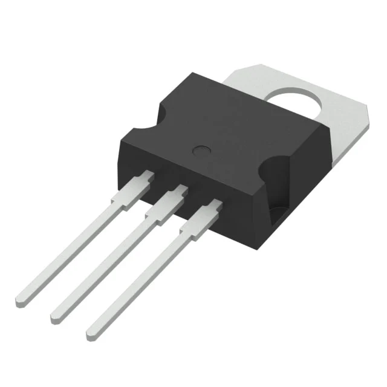 [Link](https://www.digikey.com/en/products/detail/texas-instruments/LM2940CT-5-0-NOPB/32575) | Lower dropout gives more input-voltage headroom than a conventional 7805. Fixed 5 V output and a TO-220 package suit a through-hole board. | The output capacitor must satisfy its capacitance and ESR requirements. Listed out of stock when checked; costs more and offers little thermal advantage at a fixed 9 V input. |
| **STMicroelectronics LM317T, set to 5 V** $1.13 each  [Link](https://www.digikey.com/en/products/detail/stmicroelectronics/LM317T/591677) | Adjustable output can accommodate later rail changes. TO-220 package supports straightforward hand assembly. | Adds a resistor divider and its tolerance to the output-voltage design. Still dissipates the input-output voltage difference as heat and needs minimum-load verification. |

**Choice: STMicroelectronics L7805CV.**

The L7805CV is optimal for the low-current, wall-powered device. A fixed 9 V source provides sufficient input headroom, while the fixed output simplifies the design. Additionally, the lower-dropout alternative does not reduce the nominal voltage drop. Regulator dissipation depends on actual input voltage and load current; input protection losses and thermal performance must be included in qualification.

## **LCD display subsystem: 3.3 V linear regulator**

| **Candidate and unit price** | **Advantages** | **Disadvantages** |
| --- | --- | --- |
| **STMicroelectronics LD1117V33** $1.27 each  [Link](https://www.digikey.com/en/products/detail/stmicroelectronics/LD1117V33/586012) | Fixed 3.3 V output supplies the selected display's backlight. TO-220 construction and 800 mA rated capability provide assembly convenience and potential expansion headroom. | Up to 10 mA quiescent current is substantial relative to this small load. Requires the datasheet output-capacitor arrangement; the 800 mA rating still requires thermal evaluation. |
| **Microchip MCP1700-3302E/TO** $0.50 each 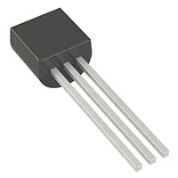 [Link](https://www.digikey.com/en/products/detail/microchip-technology/MCP1700-3302E-TO/652680) | Very low quiescent current reduces idle consumption. Through-hole TO-92 package and a ceramic output-capacitor option simplify a small board. | 250 mA current capability provides less expansion capacity than LD1117. Its 6 V maximum input prevents connection directly to the 9 V source; TO-92 heat dissipation limits usable current. |
| **Texas Instruments LM3940IT-3.3/NOPB** $2.69 each 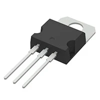 [LInk](https://www.digikey.com/en/products/detail/texas-instruments/LM3940IT-3-3-NOPB/308006) | Designed specifically for conversion from a 5 V bus to 3.3 V. TO-220 package and 1 A capability support a larger load if thermally feasible. | More expensive than either alternative. Needs at least 33 uF output capacitance within the specified ESR window; its intended input range is narrow. |

**Choice: STMicroelectronics LD1117V33.**

The LD1117V33 provides the separate 3.3 V backlight rail; the Nano and LCD logic use 5 V. Its through-hole package supports assembly and provides potential current capacity, subject to thermal limits. Compared with MCP1700, it costs more and consumes more quiescent current. Continuous external power makes this tradeoff acceptable, but the final maximum-current budget must establish the required capacity. The earlier 84.375 mA estimate is superseded. Verify output-capacitor capacitance/ESR, input headroom, and temperature before treating the rail as qualified.

## **LCD display subsystem: External power source**

| **Candidate and unit price** | **Advantages** | **Disadvantages** |
| --- | --- | --- |
| **Adafruit 63, regulated 9 V / 1 A wall adapter** $8.95 each 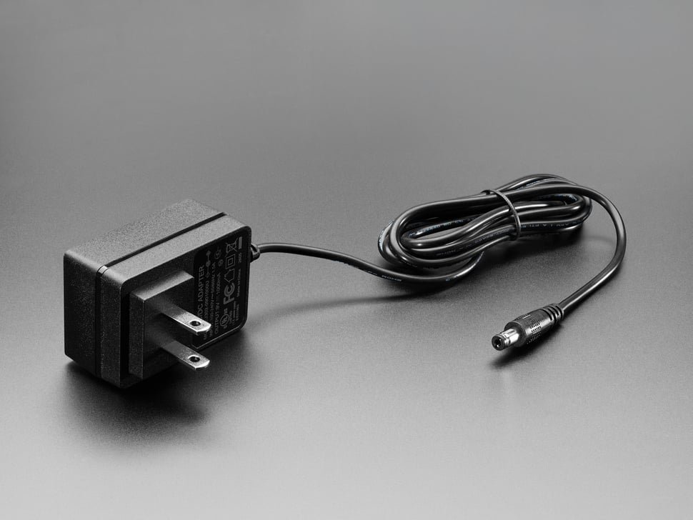 [Link](https://www.adafruit.com/product/63) | Provides headroom for the proposed 5 V stage. Fixed voltage and a center-positive 5.5/2.1 mm plug make repeatable bench operation convenient. | Requires an AC outlet and a cable. Cascaded linear conversion wastes power; the source current rating does not equal regulator thermal capability. |
| **Triad Magnetics WSU090-0800, 9 V / 0.8 A** $8.03 each  [Link](https://www.digikey.com/en/products/detail/triad-magnetics/WSU090-0800/3094975) | 9 V output preserves the required barrel input and 5 V linear regulator. Lower nominal capacity than the other adapter candidates; final current margin requires the revised power budget. | Only 0.8 A leaves less reserve for a shared team supply than the other candidates. The documented full-load ambient range is 0 to 40 C; the 11 mm plug length still needs a mechanical fit check. |
| **Triad Magnetics WSU090-2000, 9 V / 2 A** $12.43 each 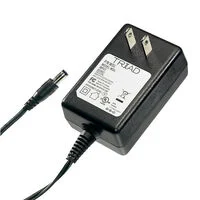 [Link](https://www.digikey.com/en/products/detail/triad-magnetics/WSU090-2000/3094951) | 9 V output retains both on-board linear stages. 2 A source capacity could support more separately fed team boards after a combined power check. | Costs more than the two alternatives and provides unnecessary capacity for this board alone. Its 77x48x31 mm body occupies more outlet space; source capacity does not remove regulator heating. |

**Current proposed choice: Triad Magnetics WSU090-1300, regulated 9 V / 1.3 A.**

[Selected adapter](https://www.digikey.com/en/products/detail/triad-magnetics/WSU090-1300/3094977). The local BOM draft records $8.65 as a historical estimate. Its 9 V output supports the required linear-regulator topology, and the center-positive 5.5/2.1 mm plug is intended to mate with the PJ-002A jack. The draft choice offers more source capacity than the earlier 1 A Adafruit option. Confirm price, mating fit, polarity and maximum path currents; adapter current capacity does not establish regulator thermal capacity. 

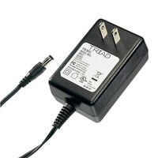{ width="200" }

*Distributor representative WSU-series image from [DigiKey](https://www.digikey.com/en/products/detail/triad-magnetics/WSU090-1300/3094977); exact model specifications are provided by the [Triad WSU090-1300 datasheet](https://catalog.triadmagnetics.com/Asset/WSU090-1300.pdf). The datasheet specifies 9 V, 1.3 A, +/-5% line/load regulation and full-load operation at 0–40 C. DigiKey listed $8.65 for one unit when checked October 30, 2026, before shipping, taxes or other fees.*

### **Custom solution considered**

A battery-holder assembly would provide portability but introduces discharge-voltage and runtime requirements that complicated the design. A custom mains supply adds isolation and protection design work with no project benefit; use a finished external adapter.

## **LCD display subsystem: DC input jack**

Provide the barrel input shown in the electrical block diagram.

| **Candidate and unit price** | **Advantages** | **Disadvantages** |
| --- | --- | --- |
| **Same Sky / CUI PJ-002A** $0.58 each 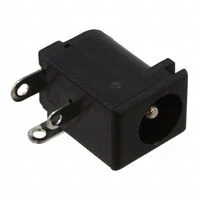 [Link](https://www.digikey.com/en/products/detail/same-sky-formerly-cui-devices/PJ-002A/96962) | Retains the part specified in the diagram. Through-hole right-angle construction integrates the input onto the PCB. | PCB footprint must match the manufacturer drawing; it is not interchangeable with every barrel jack. No inherent polarity protection or cable retention; verify mating dimensions and contact reliability. |
| **Same Sky / CUI PJ-102A** $0.70 each 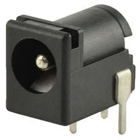 [Link](https://www.digikey.com/en/products/detail/same-sky-formerly-cui-devices/PJ-102A/275425) | Provides a right-angle PCB power connection with an internal switch. A documented through-hole alternative can be evaluated before board layout. | Requires its own footprint and mating-depth check. Costs slightly more than PJ-002A and provides no functional benefit established by this diagram. |
| **Switchcraft 722A panel jack** $4.76 each 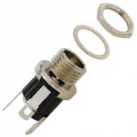 [Link](https://www.digikey.com/en/products/detail/switchcraft-inc/722A/109410) | Panel attachment transfers insertion forces to the enclosure. Solder eyelets allow flexible placement away from the PCB. | Higher unit cost than the PCB-mounted choices. Requires enclosure machining and internal wiring, increasing assembly work. |

**Choice: Same Sky / CUI PJ-002A.**

The PJ-002A matches the planned layout approach and has the lowest observed unit price of these candidates. Its mechanical rating describes the current it can carry, not current it consumes.

## **LCD display subsystem: Enclosure**

| **Candidate and unit price** | **Advantages** | **Disadvantages** |
| --- | --- | --- |
| **Custom 3D Printed Enclosure** Fabrication cost: $0.65 Custom design; no commercial product photo. | Custom LCD opening, button access and mounting bosses can follow the actual hardware. The student can revise the case as connector locations and board dimensions settle. | CAD, printer access, print time and actual material cost are still required. Printed fit, layer strength and clearance around warm regulators need checking; no weatherproof rating is claimed. |
| **Hammond 1591USBK ABS enclosure** $10.54 each 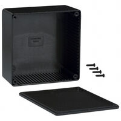 [Link](https://www.digikey.com/en/products/detail/hammond-manufacturing/1591USBK/130891) | A finished box and lid reduce fabrication work; the listing provides mechanical dimensions. Its approximately 120x120 mm footprint is more compact than the larger alternative. | LCD, button and cable openings must be machined into the finished case. Internal card guides and mounting posts reduce usable space; outline dimensions alone do not prove PCB fit. |
| **Hammond 1591ESBK ABS enclosure** $12.19 each 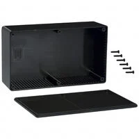 [Link](https://www.digikey.com/en/products/detail/hammond-manufacturing/1591ESBK/130876) | The approximately 190x110 mm footprint gives more length for the display and connectors. A finished lid and molded card guides reduce custom fabrication work. | It costs $1.65 more and occupies more desk area than 1591USBK. Fixed bosses and wall locations still require a fit check and machined openings; modifications need reassessment of protection. |

**Choice: Custom 3D printed enclosure.**

3D printing the enclosure permits the group to focus on designing around the circuit boards rather than worrying if everything will fit together.

## Interface and supply assignments

| Interface | Current assignment | Purpose |
| --- | --- | --- |
| Pressure board, J1 | UART1: RC2 TX / RC3 RX | Independent pressure communication. |
| Light board, J2 | UART3: RA3 TX / RA4 RX | Independent light communication. |
| Humidity board, J3 | UART4: RD0 TX / RD1 RX | Independent humidity communication. |
| J1-J3 cable contacts | Pin 1 local TX; pin 2 local RX; pin 8 GND; pins 3-7 unused | No power exported. Confirm actual TX-to-RX continuity and peer voltage compatibility before connection. |
| Nano target supply | 5 V through R17 to VTG; VOFF grounded; VBUS unused | External target supply with onboard target regulator disabled. |
| LCD logic | 5 V through R18 | LCD logic supply. |
| LCD backlight | 3.3 V; return to GND | Separate backlight supply; maximum current pending. |
| Contrast | Bourns 3362P-1-503LF, 50k | Adjustable LCD contrast. |
| LCD R/W and unused DB0-DB3 | External pull-down networks | Write-only four-bit operation with defined unused inputs. |

Local UART logic is 5 V. Each peer's thresholds, voltage tolerance and powered-off behavior must be checked. Separate UARTs replace the old proposed shared-TX connection and allow independent sensor links.

## MCU GPIO assignments

The following assignments were checked against the Revision H cost-reduced netlist. Nano contact numbers refer to the development board, not the bare PIC package.

| Function | PIC GPIO | Nano contact | Destination / configuration |
| --- | --- | --- | --- |
| LCD register select | RE0 | 31 | LCD RS, pin 4; digital output, initially low. |
| LCD enable | RE1 | 32 | LCD E, pin 6; digital output, initially low. |
| LCD DB4 | RD4 | 14 | LCD pin 11; digital output. |
| LCD DB5 | RD5 | 39 | LCD pin 12; digital output. |
| LCD DB6 | RD6 | 40 | LCD pin 13; digital output. |
| LCD DB7 | RD7 | 41 | LCD pin 14; digital output. |
| Debounced button | RB0 | 46 | U4 Schmitt-buffer output; digital input. |
| External debug LED | RF2 | 27 | R16/D5; digital output, initially low. |
| Expansion header | RC4, RC5, RC6, RC7, RA5, RA6 | 11, 12, 13, 19, 48, 49 | J5 pins 3–8 respectively; reserved GPIO, leave as inputs until an external use is defined and budgeted. |

**Proposed serial settings:** UART1, UART3 and UART4 use 9600 baud, 8 data bits, no parity and 1 stop bit (8N1), with separate TX/RX connections. These settings are the current proposal and await confirmation with the teammate boards. Disable analog mode on the digital signal pins and configure peripheral pin selection to match the UART table.

## Button and supporting component decisions

The current button input uses an external pull-up, RC network and SN74LVC1G17 Schmitt buffer. The RC network reduces contact-bounce transitions and the buffer restores a defined digital edge. This replaces the earlier description of internal pull-up and firmware-only debounce. Actual bounce behavior and effective capacitor value still require qualification. The 50k contrast trimmer permits adjustment for the installed LCD and viewing conditions. Keyed team connectors and UART isolation shunts support assembly and debugging; cable orientation and reach still require physical checks.

## Configuration status and remaining evidence

**MCC configuration update deferred.** The three UART instances and their TX/RX pins must match the table above. The configuration must also show all LCD control/data GPIO, the buffered button input, debug LED, clock settings and every other used MCU pin. Confirm those GPIO assignments against Revision H before generating code. The proposed serial format is 9600 baud, 8N1, pending teammate confirmation.

The pin tables document the hardware assignments; they do not demonstrate a completed MCC configuration. Maximum Nano/LCD currents, the updated power budget, regulator qualification and peer electrical compatibility remain pending.
